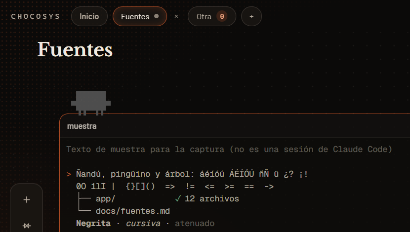

*Chocosys · proyecto sin fines comerciales, solo recreativo · repositorio sin fines de lucro · licencia PolyForm Noncommercial 1.0.0 (ver AVISO.md)*


# Chocosys

App de escritorio para Windows (y macOS, en prueba) que abre varias sesiones de [Claude Code](https://docs.anthropic.com/claude-code) en
terminales reales, las agrupa en espacios sobre un lienzo y te avisa cuál te necesita. Suma flujos (recetas YAML con
etapas y puertas que apruebas tú), un CRM básico y una segunda opinión con asesores que se confrontan.

**Página del proyecto, con el video de presentación:** https://camiloalonsomerino-spec.github.io/chocosys/

Proyecto sin fines comerciales, solo recreativo. Repositorio sin fines de lucro. Licencia
[PolyForm Noncommercial 1.0.0](LICENSE): **no es «open source» según la OSI** (detalle en [AVISO.md](AVISO.md)).

## Qué necesitas

- Windows 10 u 11. **macOS, en prueba** desde la 0.23.0: el código está, pero todavía no se ha probado en un Mac real
  ([guía y estado](docs/mac.md)).
- [Node.js](https://nodejs.org) 20 o más nuevo.
- Claude Code instalado y con tu sesión iniciada (`claude` tiene que abrir en una terminal).

## Cómo se abre desde el código

```
cd app
npm install
npm start
```

Para armar tu propio instalador (`.exe`): `npm run instalador`. Antes de armar, revisa que el paquete no lleve rutas de
un computador ni correos; `npm run instalador -- --revisar` hace solo esa revisión. El `.dmg` de macOS se arma en un
Mac con `npm run instalador -- --mac --adhoc`, o en GitHub con el flujo [Instalador de macOS](.github/workflows/mac.yml).

Las ediciones livianas se abren igual, desde su carpeta y con las dependencias de `app/` ya instaladas:
`cd lite/terminales` (o `lite/flujos`) y `npm start`. Detalle en [lite/LEEME.md](lite/LEEME.md).

Para probar sin tocar tu Chocosys de uso diario: `npx electron . --datos="<carpeta temporal>"` (otro estado, otros
hooks y otro candado de instancia).

## Qué trae

| Parte | Qué hace |
|---|---|
| Lienzo y espacios | Cada sesión es una ventana con su terminal real; cada espacio, un lienzo propio |
| Bandeja | Lo que te necesita primero (`Ctrl+Tab` salta a lo siguiente) |
| Barra de comando | `Ctrl+Shift+K`: una orden abre una sesión; `@nombre: orden` le escribe a una que ya existe |
| Flujos | Recetas en `app/flujos/*.yaml` con etapas, paralelo y puertas que apruebas en la ventana |
| CRM | Empresas, contactos, negocios en un embudo y actividades, en una base local |
| Segunda opinión | Asesores que evalúan una decisión y se confrontan antes del veredicto |
| Recursos del PC | CPU, RAM y GPU, y qué sesión consume qué |
| MCP `chocosys` | Una sesión puede leer el estado, abrir otras y lanzar flujos (aprobar puertas, no) |
| Fuentes | Títulos, interfaz y terminal con otra fuente, desde un archivo ([guía](docs/fuentes.md)) |
| Mi plan | Tu suscripción de Claude (Pro, Max o API) fija cuántas sesiones trabajan a la vez y con qué modelo |

Los atajos de la app llevan `Shift` porque `Ctrl+N`, `Ctrl+L` y `Ctrl+R` son de Claude Code. En macOS van con `Cmd`.

## Lo nuevo en la 0.23.0

- **Mi plan.** Al primer inicio (y en ☰ › Mi plan) eliges tu suscripción de Claude Code: Pro, Max 5x, Max 20x, API o sin
  límites. Todas las sesiones gastan del mismo límite de uso, así que el plan fija cuántas trabajan a la vez, el modelo
  y el esfuerzo de una sesión nueva, lo máximo que puede pedir una sesión o un flujo (en Pro, una etapa que pide Opus
  corre en Sonnet), los agentes por etapa, las tareas programadas y si se usa la Segunda opinión. Cada valor se puede
  subir a conciencia: el diálogo dice qué quedó sobre lo de fábrica, y pasar el tope desde la ventana pregunta antes.
  Los valores de fábrica son de Chocosys, no cifras de Anthropic. Si no eliges, todo sigue como antes.
- **macOS, en prueba.** La app ahora separa lo que cambia entre sistemas en una capa propia; Windows funciona igual que
  antes. El estado, lo que falta probar y cómo instalarla: [docs/mac.md](docs/mac.md).

## Lo nuevo en la 0.22.0

- **Fuentes propias.** Un archivo `fuentes.json` en `%APPDATA%\consola-agentes\fuentes\` dice qué fuente va en los
  títulos, en la interfaz y en la terminal. Sirven las instaladas en Windows y las que pongas en esa carpeta; Chocosys
  trae tres con licencia libre (Barlow, Libre Baskerville y Geist Mono). La terminal solo acepta monoespaciadas, y una
  fuente que no está deja la de fábrica con un aviso. Guía, formatos, licencias y capturas: [docs/fuentes.md](docs/fuentes.md).
- **Cambio de pestaña más rápido.** Al volver a una pestaña, cada terminal creaba de nuevo su dibujo por GPU (WebGL) y
  la ventana se pegaba entre 30 y 80 ms por terminal; ahora lo conservan hasta 6 terminales y el cambio tarda menos de
  1 ms (medido por el autor con una terminal, 14-11-2026).
- **Terminal con interlineado 1,1:** caben 33 filas donde cabían 30. Se arreglan una franja negra bajo la última fila
  y, con una ventana agrandada, la mascota que tapaba texto y el título de la pestaña que asomaba cortado.
- **Sesiones:** después de `/clear` o `/resume`, al abrir de nuevo la app se retoma la conversación vigente y no la del
  arranque. Al cerrar muchas sesiones juntas, sus servidores MCP ya no quedan vivos.



## Tus datos

Chocosys no tiene servidor y no envía nada por su cuenta. Todo lo suyo queda en `%APPDATA%\consola-agentes\`.

- **Créditos:** la primera vez que abres Chocosys ves quién la hace y para qué. No vuelve a salir; está en ☰ › Acerca de.
- **Sobre mí:** después te pregunta tu nombre o apodo, a qué te dedicas y qué quieres hacer con la app. Todo es
  opcional y se cambia o se borra en ☰ › Sobre mí. Se guarda en `sobre-mi.json`, en tu computador. Si eliges «Guardar y
  usar en mis sesiones», cada sesión nueva de Claude Code parte sabiéndolo (viaja a Claude con la conversación, como lo
  que escribes en la terminal); con «Guardar solo aquí», no sale de tu computador.

## Reportar un fallo

En ☰ › Reportar un fallo la app arma un reporte con formato fijo: qué pasó, qué esperabas, los pasos, una captura de la
ventana y las últimas líneas del registro de diagnóstico. Antes de mostrártelo tacha rutas, nombre de usuario y del
equipo, correos, RUT, teléfonos y claves. Ves la vista previa, la corriges si quieres y confirmas; se guarda en una
carpeta tuya (`reportes\`) y el texto queda copiado. **La app no envía nada.** Lo envías tú:

- por mensaje directo de Instagram al autor, [@kmilito_](https://instagram.com/kmilito_), pegando el texto y la captura
  como imagen, o
- como issue en este repositorio, con la plantilla «Reporte de fallo».

Lo que mandes se usa solo para arreglar el fallo y se borra cuando el arreglo sale. Puedes pedir que se borre antes.

## Regla de seguridad del autor

El autor **no abre enlaces, archivos ZIP, ejecutables ni adjuntos de terceros**. Por eso todo pasa por el repositorio:
issues y pull requests con texto y capturas. Las contribuciones se leen como texto y código en GitHub; nada se ejecuta
antes de leerlo. Detalle en [CONTRIBUTING.md](CONTRIBUTING.md). Una vulnerabilidad se reporta en privado, no como
issue: [SECURITY.md](SECURITY.md).

## Apoyar el proyecto

Por ahora no hay forma de aportar. Si Chocosys te sirve, úsala, pruébala y cuenta qué falla: eso ayuda. No hay ramas,
carpetas ni funciones reservadas para nadie; todo avance es público para todos.

## Estructura

| Carpeta o archivo | Qué es |
|---|---|
| `app/` | Chocosys completa (Electron, node-pty y xterm.js) |
| `app/config/` | Lo que se personaliza sin tocar código: tutorial, asesores, acciones, créditos y contacto |
| `app/fuentes/` | Las fuentes que trae Chocosys (Barlow, Libre Baskerville y Geist Mono), cada una con su licencia OFL |
| `docs/` | Guías: [fuentes de la interfaz](docs/fuentes.md), con sus capturas en `docs/img/` |
| `lite/` | Las ediciones livianas `terminales` y `flujos`: el mismo código de `app/`, con menos partes |
| `assets/logo/` | El logo (una C naranja) en SVG, PNG e ICO, y `generar.py`, que lo rehace y lo copia a la app |
| `herramientas/` | `aviso-legal.js`, que pone o quita la línea de aviso en cada archivo propio |
| `.github/` | Plantillas de issue (fallo e idea) y de pull request |
| `CHANGELOG.md` | Las versiones y lo que cambió en cada una |

## Licencia

[PolyForm Noncommercial 1.0.0](LICENSE) · Copyright (c) 2026 Camilo Merino.
