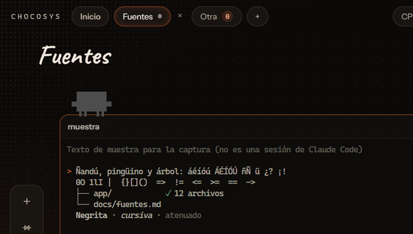
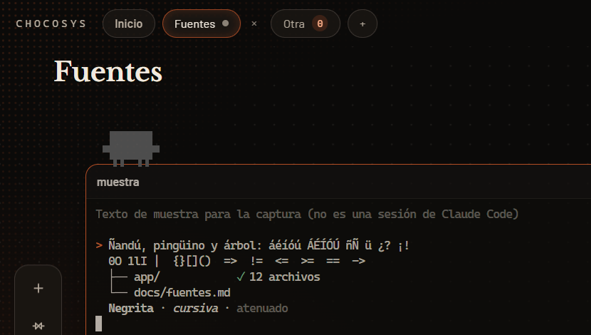
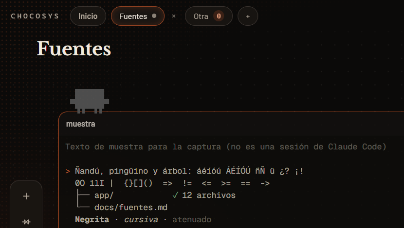
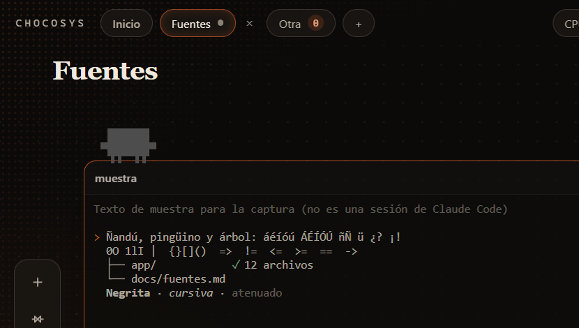

*Chocosys · proyecto sin fines comerciales, solo recreativo · repositorio sin fines de lucro · licencia PolyForm Noncommercial 1.0.0 (ver AVISO.md)*

# Fuentes de la interfaz

Chocosys usa tres fuentes: una para los títulos, otra para la interfaz (barra, botones y paneles) y otra para la
terminal. Las tres se cambian con un archivo, sin tocar el código.

## Cómo se cambian

1. Abre la carpeta de datos de Chocosys: pega `%APPDATA%\consola-agentes` en la barra del Explorador. Si abres la app
   con `--datos="<carpeta>"`, es `<carpeta>\consola-agentes`.
2. Crea ahí la carpeta `fuentes` y, dentro, el archivo `fuentes.json`:

   ```json
   {
     "titulos": "Libre Baskerville",
     "interfaz": "Barlow",
     "terminal": "Geist Mono"
   }
   ```

3. Cierra y abre Chocosys.

Las tres claves son opcionales. La que falta o queda vacía (`""`) sigue con la fuente de fábrica.

## Dónde se busca cada nombre

1. En una carpeta con ese nombre dentro de `%APPDATA%\consola-agentes\fuentes\`: tus fuentes.
2. En una carpeta con ese nombre dentro de `app\fuentes\`: las que trae Chocosys (Barlow, Libre Baskerville y Geist
   Mono).
3. Entre las fuentes instaladas en Windows (por ejemplo `Segoe UI`, `Georgia` o `Consolas`).

Al comparar con una carpeta no cuentan las mayúsculas, los espacios ni los guiones: `Libre Baskerville` encuentra
`libre-baskerville`. Si tu carpeta y una del programa se llaman igual, gana la tuya.

## Cómo se agrega una fuente propia

Una carpeta por familia, con sus archivos dentro:

```
%APPDATA%\consola-agentes\fuentes\
  fuentes.json
  mi-fuente\
    MiFuente-Regular.woff2
    MiFuente-Bold.woff2
    OFL.txt
```

- **Formatos:** `.woff2` (pesa menos), `.woff`, `.ttf` y `.otf`.
- **Pesos:** Chocosys los lee del nombre de cada archivo, como número (`400`, `700`) o como palabra (`Regular`,
  `Medium`, `SemiBold`, `Bold`, `Black`). `Italic` en el nombre la marca como cursiva. Un archivo variable (con
  `[wght]` o `Variable` en el nombre) cubre del 100 al 900. Si el nombre no dice el peso, se toma como 400.
- Con un solo archivo también funciona: la negrita la simula el navegador.

## La terminal acepta solo monoespaciadas

En la terminal cada letra ocupa una celda del mismo ancho. Antes de usar la fuente, Chocosys la mide: si no es
monoespaciada, la terminal sigue con la de fábrica y sale un aviso. Con una fuente válida, la terminal vuelve a medir
sus celdas y ajusta columnas y filas. Geist Mono es más ancha que Cascadia Code, así que en la misma ventana caben
menos columnas (en la prueba, 161 en vez de 179).

## Si algo no está

Esa parte sigue con su fuente de fábrica y la ventana muestra un aviso, en estos casos:

- `fuentes.json` está mal escrito.
- La fuente no está en ninguno de los tres lugares.
- El nombre lleva caracteres que una fuente no usa (se aceptan letras, números, espacios y guiones).

## Cómo se ve

Las cuatro capturas son de la misma ventana de prueba (datos temporales con `--datos`, sin sesiones reales). La
terminal muestra un texto de muestra escrito para la captura, y la sesión aparece en pausa porque no corre Claude Code.

| De fábrica: Instrument Sans, Caveat y Cascadia Code | Barlow y Libre Baskerville; terminal de fábrica |
|---|---|
|  |  |
| **Barlow, Libre Baskerville y Geist Mono** | **Instaladas en Windows: Segoe UI, Georgia y Consolas** |
|  |  |

Los `fuentes.json` de cada captura:

```json
{ "titulos": "Libre Baskerville", "interfaz": "Barlow" }
{ "titulos": "Libre Baskerville", "interfaz": "Barlow", "terminal": "Geist Mono" }
{ "titulos": "Georgia", "interfaz": "Segoe UI", "terminal": "Consolas" }
```

## Licencias

En el repositorio solo entran fuentes cuya licencia permite redistribuirlas, como la SIL Open Font License 1.1 (OFL).
Las tres que trae Chocosys son OFL 1.1, sin nombres reservados, y cada carpeta lleva su licencia (`OFL.txt`):

| Fuente | Copyright | Archivos |
|---|---|---|
| Barlow | 2017 The Barlow Project Authors | pesos 400, 500, 600 y 700 |
| Libre Baskerville | 2012 The Libre Baskerville Project Authors | pesos 400 y 700 |
| Geist Mono | 2024 The Geist Project Authors | pesos 400 y 700 |

Los archivos son el subconjunto latino (letras, tildes, ñ y signos del español) que publica Fontsource 5.3.0, tal cual.
Son las que usa el autor en su copia, elegidas comparando capturas.

Lo que pongas en tu carpeta `fuentes` queda en tu computador y no se sube a ningún lado. Aun así, respeta la licencia
de cada fuente, y no propongas para el repositorio fuentes comerciales ni fuentes cuya licencia no permita
redistribuirlas.

## Cómo se prueba

En `app/`, `npm run probar` corre también `scripts/probar-fuentes.js`: pesos leídos del nombre, carpeta propia y del
programa, fuente instalada, `fuentes.json` con BOM o roto, y un nombre que intenta meter CSS.
